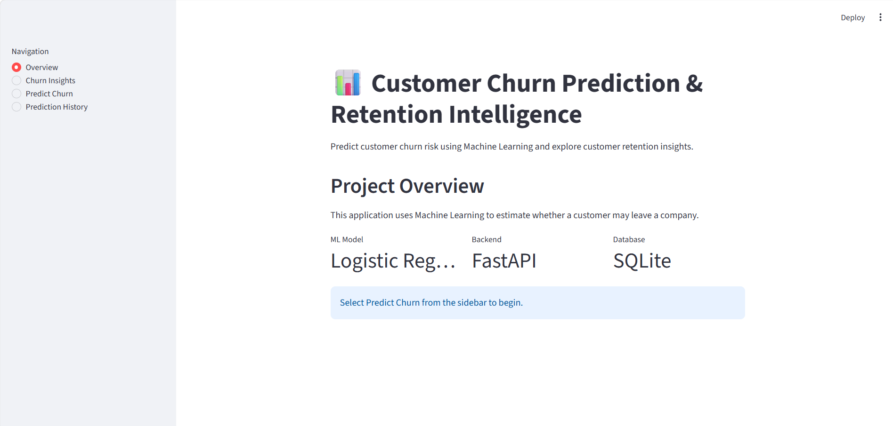
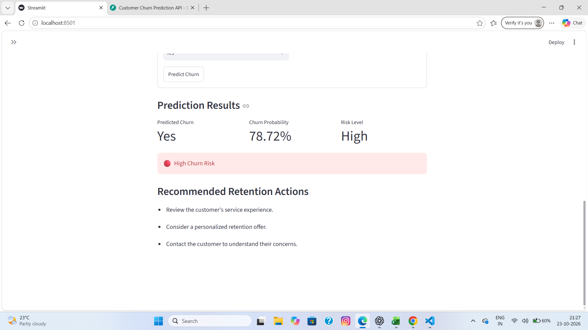

# Customer Churn Prediction & Retention Intelligence System

An end-to-end Machine Learning project that predicts customer churn risk and provides insights to support customer retention decisions.

The project combines data analysis, Machine Learning, a REST API, a database, and an interactive dashboard in one application.

## Project Overview

Customer churn occurs when customers stop using a company's products or services. Identifying customers who may leave can help businesses investigate potential issues and plan retention strategies.

This project uses the Telco Customer Churn dataset to:

* Explore historical customer churn patterns.
* Train and evaluate multiple classification models.
* Estimate churn probability for individual customer profiles.
* Display predictions through an interactive dashboard.
* Store prediction history in a SQLite database.

**Note:** Predictions are estimates based on historical data. They do not guarantee whether a customer will leave.

## Key Features

* Exploratory Data Analysis (EDA)
* Data cleaning and preprocessing
* Categorical feature encoding and numerical feature scaling
* Logistic Regression, Decision Tree, and Random Forest comparison
* Hyperparameter tuning using cross-validation
* Churn probability estimation and risk categorization
* FastAPI prediction endpoint
* SQLite prediction history
* Streamlit dashboard with interactive charts
* Automated API and database tests
* CSV export of prediction history

## 📸 Application Screenshots

### 1. Dashboard Overview

The dashboard provides an overview of the Customer Churn Prediction & Retention Intelligence System and its main capabilities.



### 2. Customer Churn Prediction

The prediction interface estimates customer churn probability, identifies the risk level, and provides retention recommendations based on the model's prediction.




## Technologies Used

| Technology           | Purpose                                                 |
| -------------------- | ------------------------------------------------------- |
| Python               | Core programming language                               |
| Pandas and NumPy     | Data manipulation                                       |
| Scikit-learn         | Machine Learning and preprocessing                      |
| Matplotlib / Seaborn | Exploratory data visualization, if used in the notebook |
| Plotly               | Interactive dashboard charts                            |
| FastAPI              | REST API                                                |
| Streamlit            | Interactive web dashboard                               |
| SQLite               | Prediction history storage                              |
| Joblib               | Saving and loading the trained model                    |
| Pytest               | Automated testing                                       |
| Jupyter Notebook     | Exploratory analysis                                    |

## Dataset

The project uses the Telco Customer Churn dataset.

* Total records: 7,043
* Original columns: 21
* Target variable: `Churn`
* Classes: `Yes` and `No`
* Customer identifier: `customerID`

The `customerID` column is excluded from model features because it is an identifier rather than a meaningful customer behavior feature.

### Data Preprocessing

The preprocessing workflow includes:

1. Inspecting data types and missing values.
2. Converting `TotalCharges` to numeric values.
3. Handling 11 blank `TotalCharges` values.
4. Separating features from the target.
5. Splitting data into training and testing sets with stratification.
6. Standardizing numerical features.
7. One-hot encoding categorical features.

The preprocessing steps are included in the model pipeline to help prevent data leakage.

## Machine Learning Models

The following models were evaluated:

* Logistic Regression
* Decision Tree
* Random Forest
* Balanced Logistic Regression
* Tuned Logistic Regression

The classification threshold and evaluation metrics were examined with particular attention to churn detection.

### Model Evaluation

Results from the current test-set experiments:

| Model                        | Accuracy | Churn Precision | Churn Recall | Churn F1-Score |
| ---------------------------- | -------: | --------------: | -----------: | -------------: |
| Logistic Regression          |   80.55% |          65.72% |       55.88% |         60.40% |
| Decision Tree                |   72.11% |          47.55% |       49.20% |         48.36% |
| Random Forest                |   78.64% |          62.54% |       48.66% |         54.74% |
| Balanced Logistic Regression |   73.81% |          50.43% |       78.34% |         61.36% |
| Tuned Logistic Regression    |   80.48% |          65.52% |       55.88% |         60.32% |

### Model Selection

Balanced Logistic Regression achieved the highest churn F1-score among these experiments and a higher churn recall than the other evaluated models.

This makes it a candidate when missing potential churners is especially costly. However, its lower precision means more customers who would stay may be flagged as potential churners.

The appropriate model depends on business costs, retention capacity, and the desired balance between precision and recall.

The test results are exploratory because the test set was used during model comparisons. A final production evaluation should use a test set that remains untouched during model selection.

## Application Architecture

```text
                 User
                   |
                   v
          Streamlit Dashboard
                   |
                   v
             FastAPI API
                   |
                   v
        Saved ML Pipeline (Joblib)
                   |
                   v
          Churn Prediction Result
                   |
             +-----+-----+
             |           |
             v           v
        Dashboard    SQLite Database
                         |
                         v
                 Prediction History
```

## Project Structure

```text

customer-churn-intelligence/
├── data/
│   └── README.md
├── models/
│   └── balanced_logistic_regression.joblib
├── notebooks/
│   └── 01_eda.ipynb
├── screenshots/
│   ├── dashboard_overview.png
│   └── churn_prediction.png
├── tests/
│   ├── test_api.py
│   └── test_database.py
├── app.py
├── dashboard.py
├── database.py
├── requirements.txt
├── README.md
└── .gitignore

```

## Installation and Setup

### 1. Clone the repository

```bash
git clone https://github.com/harsimrank288/customer-churn-intelligence.git
cd customer-churn-intelligence
```


### 2. Create a virtual environment

Windows:

```powershell
python -m venv .venv
.venv\Scripts\activate
```

### 3. Install dependencies

```powershell
python -m pip install -r requirements.txt
```

### 4. Start the FastAPI backend

Open a terminal in the project directory:

```powershell
python -m uvicorn app:app --reload
```

The API will be available at:

`http://127.0.0.1:8000`

Interactive API documentation:

`http://127.0.0.1:8000/docs`

### 5. Start the Streamlit dashboard

Open a second terminal in the project directory and activate the virtual environment if necessary.

Run:

```powershell
python -m streamlit run dashboard.py
```

Streamlit will display a local URL, typically:

`http://localhost:8501`

Keep the FastAPI backend running while using the dashboard.

### 6. Run the tests

```powershell
python -m pytest -v
```

## Dashboard Capabilities

### Overview

Provides a brief introduction to the project and its technology stack.

### Churn Insights

Displays historical churn statistics and interactive charts for contract type, internet service, payment method, tenure, and monthly charges.

### Predict Churn

Accepts customer information and sends it to the FastAPI backend to obtain a prediction.

### Prediction History

Displays previous predictions stored in SQLite and allows the history to be exported as a CSV file.

## Limitations

* Predictions depend on the quality and representativeness of the historical dataset.
* Estimated probabilities are not guarantees of future behavior.
* Risk thresholds are illustrative and have not been validated against real retention outcomes.
* Feature associations do not establish causation.
* Model performance may change when applied to new customers or different businesses.

## Future Improvements

* Add model explainability using SHAP.
* Add model monitoring and data-drift detection.
* Improve validation with an untouched final test set.
* Add business-cost-based threshold selection.
* Build a customer retention recommendation module.
* Improve database record management.
* Add deployment and continuous integration.
* Add dashboard authentication if deployed for multiple users.

## Learning Outcomes

Through this project, I practiced:

* Data cleaning and exploratory analysis
* Feature preprocessing and model pipelines
* Classification metrics and model comparison
* Cross-validation and hyperparameter tuning
* Saving and loading Machine Learning models
* Building REST APIs with FastAPI
* Building interactive dashboards with Streamlit
* Integrating SQLite with Python
* Writing automated tests with Pytest

## Author

**Harsimran Kaur**
BCA — Artificial Intelligence and Data Science

GitHub: [harsimrank288](https://github.com/harsimrank288)

Project Repository: [Customer Churn Prediction & Retention Intelligence System](https://github.com/harsimrank288/customer-churn-intelligence)

